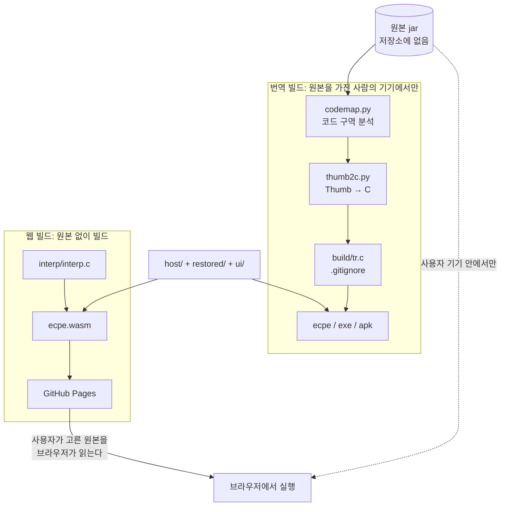
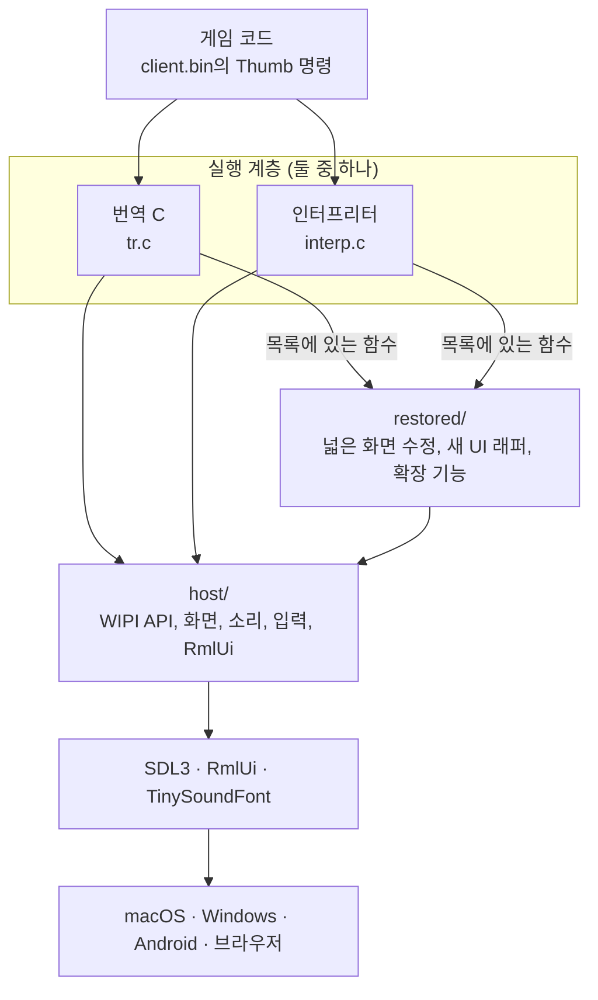

# 에픽크로니클 PE 포트

2006년 KTF 피처폰(WIPI)용 게임 「에픽크로니클 PE」를 요즘 기기에서 돌리는 실행 환경이다. 원본 Thumb 코드를 C로 기계 번역하거나(네이티브) 인터프리터로 직접 실행하고(웹), WIPI API를 SDL3 위에 다시 구현했다. 넓은 가로 화면에 맞춰 메뉴를 RmlUi로 다시 그렸고, 터치·게임패드와 몇 가지 확장 기능을 더했다. 맥·Windows·Android와 브라우저에서 돈다. 구조는 [크로노스 윙 포트](https://github.com/ring-experimental/chronos-wing)와 같다.

> [!IMPORTANT]
> **이 저장소에는 게임이 들어 있지 않다.** 원본 실행 파일, 그림, 소리, 대사, 그리고 거기서 만든 파생물(번역 C, 화면 캡처, 리마스터 그림)은 저장소에도 커밋 기록에도 배포 페이지에도 없다. 실행하려면 원본 파일(KTF 판 `010100D5.jar` 또는 `010100D2.jar`)을 직접 가지고 있어야 한다. 무엇이 어디에 있는지는 [docs/provenance.md](docs/provenance.md)에 적었다.

브라우저 판: <https://ring-experimental.github.io/ecpe/>
페이지를 열고 가지고 있는 원본 jar(또는 그것을 담은 zip)를 고르면 그 기기 안에서 풀어 실행한다. 파일은 어디로도 전송되지 않는다.

## 빌드 종류

| 대상 | 명령 (`native/`에서) | 게임 코드 실행 방식 | 원본이 필요한 때 | 공개 배포 |
|---|---|---|---|---|
| 웹 | `make web` | 인터프리터 | 실행할 때(사용자가 고름) | 한다 |
| 맥(인터프리터) | `make interp JAR=<jar>` | 인터프리터 | 실행할 때 | 안 한다 |
| 맥 | `make JAR=<jar>` | 빌드 때 C로 번역 | 빌드할 때 | 안 한다(결과물에 원본이 들어감) |
| Windows | `make windows JAR=<jar>` | 빌드 때 C로 번역 | 빌드할 때 | 안 한다 |
| Android | `make android JAR=<jar>` | 빌드 때 C로 번역 | 빌드할 때 | 안 한다 |

`JAR`를 주지 않으면 저장소 루트의 `origin/010100D5.jar`를 쓴다(`origin/`은 .gitignore로 막혀 있다). `JAR`에는 jar를 담은 원본 zip을 줘도 된다.

## 지원하는 원본 판

| 판 | 버전 | 실행 이미지 | 비고 |
|---|---|---|---|
| KTF `010100D5` | 01.00.00 | `client.bin1236` | 기준 판. `restored/`와 `host/`의 주소는 이 판의 것이다 |
| KTF `010100D2` | 01.00.02 | `client.bin1224` | 기준 판과 함수 2212개가 같고 120개가 조금 다르다(키 아이템 보정 등). 주소는 대응표로 맞춘다 |

판마다 다른 것(함수·데이터 주소, GOT 칸, 게임 객체 필드)은 모두 `native/ver/<AID>.map`에 있다. 기준 판도 빈 표 하나다. 자세히는 [native/README.md](native/README.md) '원본 판'. 다른 판을 네이티브로 빌드할 때는 빌드 폴더를 나눈다: `make B=build-d2 JAR=<010100D2 zip 또는 jar>`.



## 빨리 해 보기

웹 빌드는 원본 없이 만들어진다.

```bash
brew install emscripten ninja rustup uv
rustup target add wasm32-unknown-unknown
cd native
make web                       # 처음에는 deps.sh web이 SDL3, FreeType, RmlUi를 받아 빌드한다. 결과: native/build/web
python3 -m http.server -d build/web 8765
```

`http://localhost:8765`을 열고 원본 파일을 고른다. 네이티브 빌드와 조작법은 [native/README.md](native/README.md)에 있다.

## 설정과 의존성

이 저장소에는 특정 기계의 경로를 적지 않는다. 경로는 모두 저장소 안의 상대 경로이고, 기계마다 다른 것은 설정으로 넘긴다.

| 무엇 | 어디서 정하나 |
|---|---|
| 원본 jar | `make JAR=<경로>` (기본 `origin/010100D5.jar`) |
| 파이썬 도구(capstone, Pillow) | 저장소 루트 `pyproject.toml`·`uv.lock`. Makefile은 `uv run`, 스크립트는 `work/tools/py`로 부른다. 바꾸려면 `make PY=…`, `ECPE_PY=…` |
| C/C++ 라이브러리(SDL3, FreeType, RmlUi) | `native/deps.sh`가 판과 해시를 고정해 `native/build/deps`에 받는다. 다른 곳이면 `make RML=…`, `WSDL=…`, `WRML=…`, Android는 `CW=…` |
| Rust 크레이트(smaf-player, ab_glyph) | `work/tools/*/Cargo.lock` |
| Android SDK·NDK·JDK | `ANDROID_HOME`, `ANDROID_NDK_HOME`, `JAVA_HOME` (없으면 Homebrew 자리) |
| 시험 스크립트(`work/tools`, `work/ui/run`) | `work/config.sh`가 저장소 위치를 스스로 찾는다. 기계별 값(WIE 실행 파일, 다른 파이썬, 세이브 폴더)은 `work/config.local.sh`(.gitignore, `work/config.local.sh.example` 참고)나 환경 변수로 |

## 구조



| 경로 | 내용 |
|---|---|
| `native/host/` | WIPI API와 플랫폼 계층(SDL3, 소리, 입력, RmlUi 호스트) |
| `native/interp/` | Thumb-1 인터프리터(웹, `make interp`) |
| `native/restored/` | 원본 동작을 분석해 새로 쓴 C: 넓은 화면 수정, 메뉴 래퍼(`ui_<영역>.c`), 확장 기능. 목록은 `list.txt`, `list.d/` |
| `native/ui/` | RmlUi 문서(`*.rml`, `*.rcss`)와 규칙(`README.md`) |
| `native/web/` | 웹 페이지, 원본 가져오기(`gamedata.js`), 서비스 워커 |
| `work/tools/` | 번역기(`thumb2c.py`), 역어셈블(`tdis.py`), 소리·글꼴 변환(Rust), 구동 도구(`nctl.sh`, `tofield.sh`) |
| `work/ui/` | 메뉴 현대화 자료: `survey/`(원본 화면 조사 기록, 캡처는 올리지 않는다), `run/`(영역별 시험 스크립트) |
| `docs/` | 원본 미포함 원칙, 웹 빌드 |

- 웹 빌드, 가져오기, 저장, 배포: [docs/web.md](docs/web.md)
- 원본 미포함 원칙과 점검 방법: [docs/provenance.md](docs/provenance.md)

## 이어서 작업하기

```bash
cd native && make -j8          # origin/010100D5.jar 필요. 결과는 native/build/ecpe
build/ecpe                     # 실제 저장으로 실행(F2: 원작 그리기 전환, F11: 창 전환)
```

- 메뉴를 고칠 때는 `native/ui/README.md`(규칙, 래퍼 틀, 시험 방법)부터 읽는다. 화면별 원본 구조는 `work/ui/survey/*.md`에 있다.
- 문서(`native/ui/*.rml`, `*.rcss`)만 고쳤으면 다시 빌드하지 않고 `ECPE_UI_DIR=$PWD/native/ui`로 띄워 `nctl.sh <폴더> uireload`로 다시 읽는다.
- 시험은 항상 저장 사본으로 한다(`work/tools/tofield.sh`가 `$ECPE_USER_SAVE`에서 복사한다. 기본은 SDL 저장 폴더, 맥은 `~/Library/Application Support/ecpe/save`).
- 영역별 시험 스크립트: `work/ui/run/m_<영역>/`(dialog `tools/go.sh`·`door.sh`·`proof.sh`, battle `tob.sh`·`towin.sh`, shop `tools/open.sh`, title `tools/`, fmcore `../m_fmcore_tour.sh`). 모두 `work/config.sh`를 읽는다.
- 전투 시험은 `work/shots/b512/save`(저장소 밖, 필드에서 바로 전투가 나는 저장)를 쓴다.
- 화면 여러 장을 붙여 보려면 `work/tools/py work/tools/sheet.py out.png a.png b.png ...`.

## 남은 일

`native/README.md`의 "메뉴 현대화" 절에 확인하지 못한 경로가 있다. 그 밖에:

- 실제 플레이로 각 화면을 돌아보며 어색한 배치 고치기(지금까지는 폭 240·568·640의 대표 상태만 확인했다).
- 전투파티 화면의 파티 줄은 HP/MP가 숫자뿐이고 게이지가 없다(다른 화면과 다르다).
- 원작에 없던 표시(화면별 키 안내, 상점 "구입 후" 잔액, 전투 단축키 안내)를 유지할지는 정해지지 않았다. 전투 아이템 탭 이름은 효과로 지어 붙인 것이다(`restored/ui_battle.c`의 `tab_names`).
- Windows 빌드(`make windows`, `native/README.md` 'Windows')는 빌드만 확인했다. 실제 Windows에서 실행·소리·저장·게임패드를 돌려 봐야 한다.
- 미니게임(트리플 슬롯, 저들의영웅)은 타이틀 경로만 확인했다. 필드에서 여는 경로는 남았다.
- 웹 빌드: 맥 크롬 계열에서 가져오기, 첫 실행 재시작, 타이틀, 새 게임 첫 장면, 소리 변환까지 확인했다. 폰 실기기, iOS Safari, 세이브 내보내기·불러오기, 게임패드는 아직이다.
- 터치·게임패드(`native/README.md` '터치와 게임패드'): 남은 미확인: 획득 알림(같은 키 처리 `0x23408`라 OK로 닫힐 것으로 추정), 에픽한마디·정보이용료의 ▲▼(긴 글이 없어 안 뜸), 엔딩에서 부르는 랭킹 화면, 저장 슬롯 오류 팝업(6, 7, 9), 3인 파티 합체기. 스킬 보기 전용(상태 3)은 원본에 들어가는 길이 없다(poke로 배치만 봤다). 작은 배치 문제: 조합 목록에서 대상 선택을 취소하면 줄 강조가 빈다, 터치 키 안내 버튼이 오른쪽 아래 아군을 조금 가린다, 전투 결과 카드 높이가 쪽마다 조금 다르다. 장비 상점은 목록 안에서 분류 탭을 바꿀 수 없다(원본도 CLR로 돌아가야 한다).

## 출처

- WIPI API 동작: [WIE](https://github.com/dlunch/wie) (MIT). 소스를 참고해 C로 옮겼고 링크하지 않는다.
- SDL3 (zlib), RmlUi (MIT), FreeType (FTL), TinySoundFont (MIT)
- SMAF 변환: smaf-player (MIT)
- 글꼴: Neo둥근모 (OFL 1.1, `native/third_party/neodgm-LICENSE.txt`), Galmuri9 (OFL 1.1, `native/third_party/Galmuri-LICENSE.txt`)
- 사운드폰트: 1MGM (CC BY 3.0, `native/third_party/1mgm.txt`)

「에픽크로니클 PE」와 그 그림, 소리, 글의 권리는 원 권리자에게 있다. 이 저장소는 그 어느 것도 배포하지 않는다.
