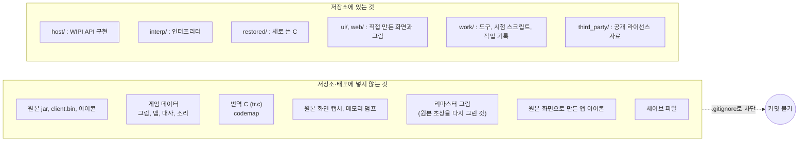
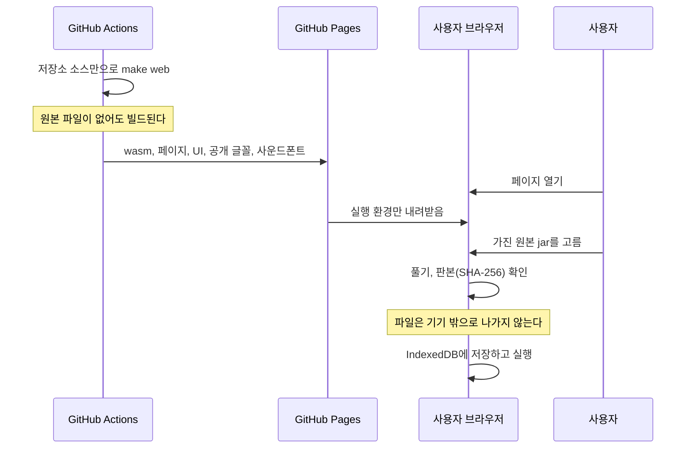

# 원본 미포함 원칙

이 저장소와 배포 페이지에는 게임 원본도, 원본에서 만든 파생물도 없다. 이 문서는 그 경계가 어디인지, 어떻게 지키고 어떻게 확인하는지 적는다. 원칙은 [크로노스 윙 포트](https://github.com/ring-experimental/chronos-wing/blob/main/docs/provenance.md)와 같다.

## 경계



## 산출물마다

| 산출물 | 어디서 나오나 | 어디에 있나 | 저장소 | 웹 배포 |
|---|---|---|---|---|
| 원본 `010100D5.jar`, `big.icon` | 사용자가 가진 원본 | `origin/` 또는 `make JAR=<경로>` | 없음 | 없음 |
| `client.bin`, 게임 데이터 | 원본 jar를 푼 것 | `native/build/game`, 브라우저 저장소 | 없음 | 없음 |
| `tr.c`, `codemap.json` | `thumb2c.py`, `codemap.py`가 `client.bin`에서 | `native/build` | 없음 | 없음 |
| 소리 이벤트 | 게임이 실행 중에 넘기는 MMF를 smafev가 변환 | 메모리 | 없음 | 없음 |
| 원본 화면 캡처, 메모리 덤프, 시험 세이브 | 분석과 시험의 중간물 | `work/shots`, `work/ui/survey/shots`, `work/ui/run/**`(스크립트만 올린다) | 없음 | 없음 |
| 리마스터 일러스트 | 원본 초상을 바탕으로 다시 그린 그림 | `work/illust/gpt`, `out`, `frames` | 없음 | 없음 |
| 앱 아이콘(Android·Windows) | 빌드 때 타이틀 화면에서 자름 | `native/build/android`, `native/build/ecpe.ico` | 없음 | 없음 |
| 설치 아이콘(웹) | 사용자가 넣은 `big.icon`을 브라우저가 키움 | 브라우저 저장소 | 없음 | 없음 |
| 세이브 | 플레이 결과 | SDL 저장 폴더, 브라우저 저장소 | 없음 | 없음 |
| 판 대응표 `native/ver/*.map` | `vermap.py`가 두 판의 `client.bin`을 맞대어 얻은 주소 짝과 손으로 정한 규칙 | `native/ver` | 있음(주소만) | 빌드 결과에 표로 |
| `ecpe.wasm`, `smafev.wasm` | 저장소의 소스만으로 빌드 | `native/build/web` | 없음(빌드 결과) | 있음 |
| `font.gly` | 공개 글꼴(Neo둥근모, Galmuri9)을 `glyphdump`로 래스터화 | `native/build`, 배포 꾸러미 | 없음(빌드 결과) | 있음 |
| 글꼴, 사운드폰트 | 공개 자료(OFL 1.1, CC BY 3.0) | `native/third_party` | 있음 | 있음 |
| 웹 아이콘 | 새로 그린 SVG와 그것을 그린 PNG | `native/web/icon.*` | 있음 | 있음 |

## `restored/`와 작업 기록에 대해

`native/restored/`의 C는 원본 바이너리의 동작을 분석해 새로 쓴 코드다. 원본의 기계어나 그것을 기계 번역한 C를 옮겨 적은 것이 아니다. 다만 원본 안의 위치를 가리키는 값은 들어 있다.

- 함수 주소와 전역 변수 주소(파일 오프셋, 예: `0x205c4`, `GOT + 0x294`)
- 구조체 필드 오프셋
- 기능 설명에 필요한 짧은 식별 값(아이템 번호, 스토리 플래그 번호, 마을 이름)
- 판 대응표(`native/ver/*.map`): 기준 판 주소와 다른 판 주소의 짝, 구조체 오프셋 규칙. 숫자만 있다

`work/`의 작업 기록(`*.md`)과 시험 스크립트도 같다. 주소, 구조, 수치 관찰과 메뉴에 보이는 짧은 낱말을 적었고, 원본 파일이나 그 덤프, 화면 캡처는 싣지 않았다. 이 값들만으로는 게임이 되지 않는다. 실행에는 언제나 사용자가 가진 원본 파일이 필요하다.

## 커밋 기록

이 저장소의 공개 기록은 원본 파생물이 없는 상태에서 새로 시작했다. 작업 중 로컬 기록에 있던 원본 화면 캡처(`work/ui/survey/shots`)는 공개 기록에 들어 있지 않다.

## 웹 배포가 원본 없이 되는 이유



## 확인하는 방법

```bash
# 추적 파일에 원본이나 원본 파생물이 없는가
git ls-files | grep -Ei '\.(jar|zip|sav|ecsave|raw|ppm|bin)$|client\.bin|work/(shots|illust/(gpt|out|frames))|survey/shots' && echo "섞였다"
# 그림 파일은 직접 만든 것만 있는가(웹 아이콘)
git ls-files '*.png' '*.jpg' '*.gif'
# 기계 전용 경로가 없는가
git grep -nE '/Users/|/home/[a-z]' -- . ':!docs/provenance.md'
```

배포 워크플로(`.github/workflows/pages.yml`)는 원본이 없는 러너에서 `make web`을 돌리므로, 원본이 있어야만 빌드되는 것이 섞이면 실패한다. 빌드 뒤에는 결과 폴더에 번역 C와 게임 데이터가 없는지 다시 본다.
