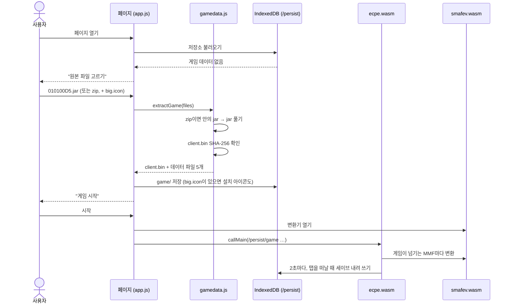
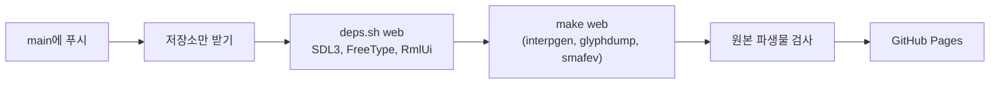

# 웹 빌드

브라우저에서 도는 판이다. 페이지에는 실행 환경만 있고, 게임은 사용자가 가진 원본 파일을 브라우저가 직접 읽어 실행한다. 구조는 [크로노스 윙 웹 빌드](https://github.com/ring-experimental/chronos-wing/blob/main/docs/web.md)와 같다.

> 배포되는 파일 어디에도 원본과 그 파생물이 없다. → [provenance.md](provenance.md)

## 빌드

```bash
brew install emscripten ninja rustup uv
rustup target add wasm32-unknown-unknown
cd native
make web                                # 처음에는 deps.sh web이 SDL3, FreeType, RmlUi를 받아 빌드한다
python3 -m http.server -d build/web 8765
```

`native/build/web`이 결과다. 이 폴더를 그대로 정적 호스팅에 올리면 된다.

| 파일 | 내용 |
|---|---|
| `index.html`, `app.js` | 페이지와 진행(저장소 연결, 가져오기, 시작, 세이브 파일) |
| `gamedata.js` | 원본 풀기와 판본 확인 |
| `ecpe.js`, `ecpe.wasm` | 호스트 + 인터프리터(`interp/interp.c`) |
| `ecpe.data` | RmlUi 문서, 공개 글꼴(Neo둥근모, Galmuri9), 글리프 표 `font.gly`, 사운드폰트 |
| `smafev.wasm` | SMAF 변환기(`work/tools/smafev`). 게임이 실행 중에 넘기는 소리를 바꾼다 |
| `licenses/` | 글꼴과 사운드폰트의 라이선스 |
| `sw.js`, `manifest.webmanifest`, `icon*` | PWA |

## 처음 열 때



두 번째부터는 저장된 데이터를 바로 쓰므로 `게임 시작`만 누르면 된다. 크로노스 윙과 달리 가져올 때 글꼴과 소리를 미리 만들지 않는다. 글꼴은 공개 글꼴로 빌드 때 만든 것을 쓰고(원작의 비트맵 글꼴이 아니라 WIE와 같은 Neo둥근모), 소리는 `res.gmf` 안에 압축되어 있어 게임이 실행 중에 꺼내 넘길 때 바꾼다.

지원하는 원본은 KTF 판 `010100D5`와 `010100D2`다(실행 이미지 SHA-256으로 가린다). 판끼리 다른 주소는 `native/ver/<AID>.map`으로 맞춘다(native/README.md '원본 판'). 그 밖의 판은 거부한다. 세이브는 판마다 따로 둔다(`/persist/save`, `/persist/save-010100D2`).

첫 실행은 원작대로 "속도최적화"를 한 뒤 재시작을 요청한다. 네이티브와 같이 호스트가 그 종료만 받아 바로 다시 시작한다.

## 저장소 배치

Emscripten의 가상 파일 시스템 위에서 돈다.

| 경로 | 저장 | 내용 |
|---|---|---|
| `/ui`, `/font.gly`, `/1mgm.sf2` | 배포 꾸러미(`ecpe.data`) | UI 문서와 글꼴, 글리프 표, 사운드폰트 |
| `/persist/game/` | IndexedDB | 원본에서 푼 `client.bin`과 데이터 파일 |
| `/persist/icons/` | IndexedDB | 원본 `big.icon`으로 만든 설치 아이콘 |
| `/persist/save/` | IndexedDB | 세이브(`slot<n>.sav`, `ext<n>.ini`, `gopt.sav`)와 `ui.ini` |
| `/tmp/` | 메모리 | 세이브 내보내기·불러오기의 임시 파일 |

브라우저 데이터를 지우면 `/persist`가 통째로 사라진다. 세이브는 환경설정의 「세이브 데이터」에서 파일(`.ecsave`)로 내보낼 수 있다. 웹에서는 내보내기가 내려받기로, 불러오기가 페이지의 파일 고르기 화면으로 바뀐다(`host/savefile.c`).

## 네이티브와 다른 점

| 항목 | 네이티브 | 웹 |
|---|---|---|
| 게임 코드 | 번역 C | 인터프리터 |
| 메인 루프 | 다음 타이머까지 잔다 | 화면 주기마다 한 번(`web_tick`) |
| 메모리 보호 | 보호 페이지 | 접근마다 범위 검사 |
| 소리 변환 | smafev 정적 라이브러리 | `smafev.wasm`을 페이지를 거쳐 부름(`host/audio.c`) |
| 파일 창 | OS 파일 창 | 페이지의 고르기 화면, 내려받기 |
| 게임 화면 폭 | 모니터 비율(240~640) | 시작할 때의 페이지 비율. 세로로 든 터치 기기도 가로 비율로 잡고 돌리라는 안내를 띄운다 |
| 전체화면 | 환경설정 「화면」 줄, F11 | 터치 기기는 시작할 때 전체화면 + 가로 고정, 데스크톱은 F11(페이지가 처리). 환경설정의 「화면」 줄은 없다 |
| 리마스터 일러스트 | 그림이 있으면 쓴다 | 없다(원본 파생물이라 배포하지 않는다). 원작 도트 초상 |
| 종료 | 프로세스 종료 | 저장 후 "다시 시작" 화면 |

## 오프라인과 갱신

서비스 워커(`sw.js`)는 실행 환경 파일만 캐시한다. 게임 데이터와 세이브는 IndexedDB에 있고 캐시에 넣지 않는다. 네트워크를 먼저 쓰고 실패하면 캐시로 답하므로, 새 빌드는 다음에 열 때 바로 적용되고 한 번 연 뒤에는 오프라인으로도 열린다. 설치 아이콘 처리는 크로노스 윙과 같다(원본 아이콘은 그 기기의 저장소에만 있다).

## 배포

`main`에 푸시하면 GitHub Actions가 빌드해 Pages에 올린다(`.github/workflows/pages.yml`).



러너에는 원본이 없다. 원본이 있어야 빌드되는 것이 섞이면 이 단계가 실패한다.

## 시험용 주소 인자

| 인자 | 동작 |
|---|---|
| `?touch=1` | 터치 기기가 아니어도 화면 패드를 켠다 |
| `?width=<폭>` | 게임 화면 폭을 정한다(240~640) |

## 확인한 것과 못 한 것

맥의 크롬 계열 브라우저에서 jar + big.icon 가져오기, 첫 실행 최적화 뒤 재시작, 새 UI 타이틀 메뉴, 새 게임 첫 이벤트 장면, 소리 변환(MMF → 이벤트)을 확인했다. 맥에서 같은 인터프리터 빌드(`make interp`)가 번역 빌드와 같은 필드 화면에 서는 것도 확인했다. 폰 실기기, iOS Safari, 세이브 내보내기·불러오기, 게임패드, 앱 설치 아이콘은 아직 확인하지 않았다.
